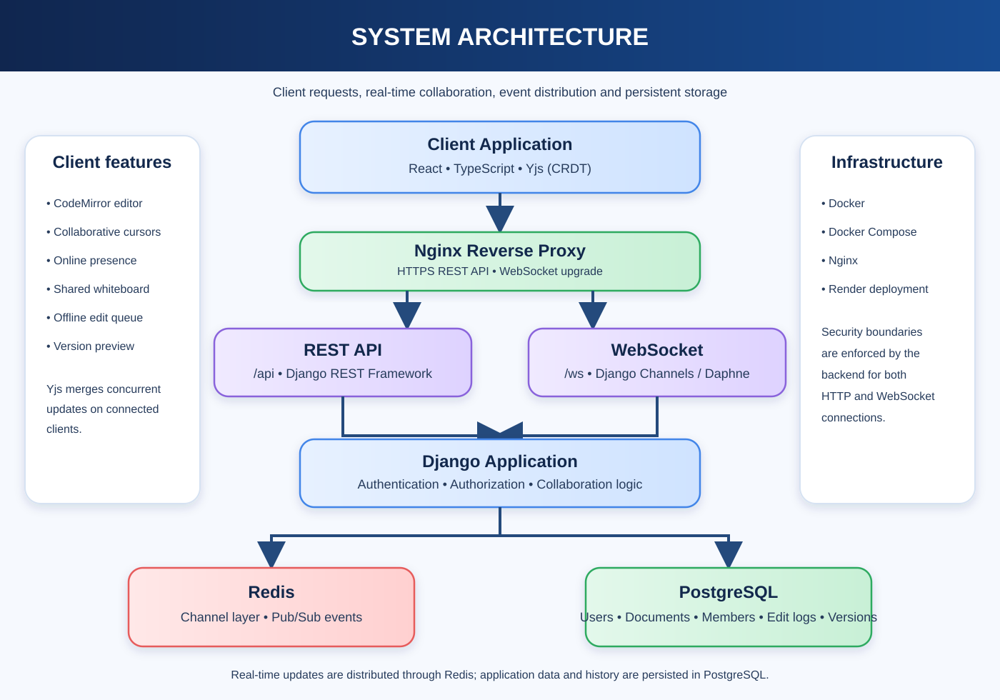

<div align="center">

# Real-Time Collaborative Code & Whiteboard Editor

**Work together in real time — edit code, draw, share and collaborate.**

A full-stack collaboration platform where multiple users can edit code files and digital whiteboards simultaneously, with live cursors, presence indicators, role-based access and version history.

[](https://collab-editor-w8ni.onrender.com)
[](https://collab-editor-w8ni.onrender.com/api/docs/)

**Developed for the IT-Simplera Solutions Full Stack Development Internship — Batch 02, Project 01.**

</div>

---

## Overview

The application provides a shared workspace where users can create code documents or whiteboards, invite collaborators, and work together in real time.

It uses **Yjs CRDT technology** to synchronize concurrent changes while minimizing conflicts during simultaneous editing. The backend manages authentication, document access, sharing permissions, collaboration events and persistent storage.

> **Live deployment note:** The application is hosted on Render's free infrastructure. After a period of inactivity, the first request may take up to a minute while the service starts.

## Key Features

### Authentication and user management
- User registration and login.
- Secure password hashing.
- JWT access and refresh token authentication.
- Token refresh functionality.
- Logout with refresh-token blacklisting.
- User profile management through the API.

### Document management
- Create code documents and whiteboards.
- Rename, delete and duplicate documents.
- View documents owned by the user.
- Access documents shared by other users.
- Dashboard for collaborative workspaces.

### Role-based sharing and permissions

| Role | Permissions |
|---|---|
| **Owner** | Full document control, including sharing and member management |
| **Editor** | View and modify document content |
| **Viewer** | View document content without making changes |

Sharing capabilities include email invitations, role changes, member removal, shareable links and joining documents through sharing links. Permissions are enforced by the server for both REST API requests and WebSocket connections.

### Real-time collaboration
- Simultaneous editing by multiple users.
- Instant synchronization using WebSockets.
- Conflict-resistant editing using Yjs CRDTs.
- Live collaborator cursors with names and colors.
- Online users panel.
- Queued offline edits synchronize after reconnecting.
- Redis-backed communication between server instances.

### Collaborative code editor
Powered by **CodeMirror 6**:
- Syntax highlighting for JavaScript, Python, Java, C++, and HTML.
- Line numbers, automatic indentation and bracket matching.
- Programming language selection.
- Automatic saving and real-time collaborative editing.

### Interactive whiteboard
- Freehand drawing.
- Rectangle, circle, arrow and text tools.
- Custom colors and stroke widths.
- Move, resize and delete objects.
- Zoom and pan.
- Undo and redo.
- Real-time synchronization and persistent content.

### Version history and recovery
- Automatic snapshots every 30 seconds or after 50 changes.
- Version timeline with author and timestamp information.
- Read-only version previews.
- Restore previous versions.
- Restoring a version creates a new version rather than deleting existing history.

---

## Technology Stack

| Layer | Technologies |
|---|---|
| Frontend | React, TypeScript, Vite |
| Code editor | CodeMirror 6 |
| Real-time synchronization | Yjs, CRDT |
| Backend | Python, Django, Django REST Framework |
| Authentication | SimpleJWT |
| WebSocket | Django Channels, Daphne |
| Messaging / channel layer | Redis |
| Database | PostgreSQL |
| Web server / reverse proxy | Nginx |
| Containerization | Docker, Docker Compose |
| Deployment | Render |
| Testing | Django test runner, Coverage.py, k6 |

## System Architecture

The diagram below shows the client application, request routing, backend services, real-time messaging and persistent storage.

<p align="center">
  
</p>

### How collaboration works

1. A user authenticates and opens a document.
2. The backend verifies the user's document permissions.
3. The client establishes a WebSocket connection for real-time collaboration.
4. Yjs generates and synchronizes document updates.
5. Django Channels receives collaboration events.
6. Redis distributes events to connected collaborators.
7. Connected clients apply updates and display changes.
8. The backend records document changes for persistence and version history.

The backend does not interpret the contents of code documents. It handles authorization, synchronization, event distribution and persistence.

---

## Project Structure

```text
collab-editor/
├── client/
│   ├── src/
│   │   ├── components/
│   │   ├── pages/
│   │   ├── context/
│   │   ├── services/
│   │   ├── data/
│   │   └── assets/
│   └── package.json
├── server/
│   ├── config/              # Settings, URLs and ASGI routing
│   ├── users/               # Authentication and user management
│   ├── documents/           # Documents, sharing, versions and WebSockets
│   ├── manage.py
│   └── requirements.txt
├── scripts/
│   ├── test_roles.sh        # HTTP role-permission checks
│   ├── test_sharing.sh      # 26 sharing checks
│   └── test_ws.py           # 13 WebSocket checks
├── loadtest/
│   ├── ws_load.js           # k6 WebSocket load test
│   └── recorded-results/
├── docs/
│   └── images/
│       └── system-architecture.svg
├── docker-compose.yml
├── Dockerfile.render
├── render.yaml
├── .env.example
└── README.md
```

---

## Getting Started

### Prerequisites

- Git
- Docker
- Docker Compose

### 1. Clone the repository

```bash
git clone https://github.com/vintontechnologies/collab-editor.git
cd collab-editor
```

### 2. Configure environment variables

Create the environment file:

```bash
cp .env.example .env
```

Generate a Django secret key:

```bash
openssl rand -hex 32
```

Set the generated value as `SECRET_KEY` in `.env`. Configure the other required application, database and Redis variables using the names and defaults documented in `.env.example`.

### 3. Build and start the application

```bash
docker compose up -d --build
```

Check container status:

```bash
docker compose ps
```

View application logs:

```bash
docker compose logs -f
```

### 4. Open the application

| Service | Local address |
|---|---|
| Frontend | http://localhost:8080 |
| Backend API | http://localhost:8080/api/ |
| Swagger API documentation | http://localhost:8080/api/docs/ |

The default web port is `8080`. It can be changed through `WEB_PORT` in the environment configuration.

---

## Testing

The project includes backend unit tests, HTTP end-to-end tests, WebSocket checks and load testing.

### Backend unit tests

From the project root:

```bash
cd server
python manage.py test
```

**Recorded result:** 33 tests passed. The suite covers authentication, document permissions, sharing, version history and WebSocket functionality.

### Code coverage

From the `server/` directory:

```bash
coverage run --source=users,documents manage.py test
coverage report
```

**Recorded coverage:** 91%.

### End-to-end tests

The scripts in `scripts/` run against a live server. Start the application first and ensure each script is configured to target the intended server.

| Script | Purpose | Checks |
|---|---|---:|
| `scripts/test_roles.sh` | Role rules over HTTP | Role-permission checks |
| `scripts/test_sharing.sh` | Sharing functionality over HTTP | 26 |
| `scripts/test_ws.py` | WebSocket collaboration checks | 13 |

Run from the repository root:

```bash
bash scripts/test_roles.sh
bash scripts/test_sharing.sh
python3 scripts/test_ws.py
```

The WebSocket test can also be run through Nginx in the Docker stack. The `.sh` files are Bash scripts and must be run with `bash`, not `python3`.

### WebSocket load testing with k6

The k6 test simulates multiple users editing the same document and measures how long an edit takes to reach other connected users. The performance target in the project brief is **under 200 ms**.

Run the test using Docker from the repository root:

```bash
docker run --rm --network host \
  -v "$PWD/loadtest:/loadtest" \
  -e USERS=20 \
  -e HOST=127.0.0.1:8080 \
  grafana/k6 run /loadtest/ws_load.js
```

#### Recorded performance results

| Scenario | Median | 95th percentile |
|---|---:|---:|
| 5 users — initial implementation | 166 ms | 315 ms |
| 5 users — optimized event relay | 76 ms | 198 ms |
| 20 users — before database connection reuse | 274 ms | 15.7 s |

The optimized 20-user result is not included in the recorded results.

---

## API Documentation

Interactive API documentation is available through Swagger UI:

**[Open Swagger API Documentation](https://collab-editor-w8ni.onrender.com/api/docs/)**

### Main REST API endpoints

| Method | Endpoint | Purpose |
|---|---|---|
| POST | `/api/auth/register/` | Register a user |
| POST | `/api/auth/login/` | Authenticate a user |
| POST | `/api/auth/refresh/` | Refresh JWT token |
| POST | `/api/auth/logout/` | Logout and blacklist refresh token |
| GET, PATCH | `/api/auth/me/` | Retrieve or update user profile |
| GET, POST | `/api/documents/` | List or create documents |
| GET, PATCH, DELETE | `/api/documents/{id}/` | Retrieve, update or delete a document |
| POST | `/api/documents/{id}/duplicate/` | Duplicate a document |
| GET, POST | `/api/documents/{id}/members/` | List or invite collaborators |
| PATCH, DELETE | `/api/documents/{id}/members/{user_id}/` | Update role or remove collaborator |
| GET, PUT | `/api/documents/{id}/link/` | Retrieve or configure sharing link |
| POST | `/api/documents/join/{id}/` | Join through a sharing link |
| GET | `/api/documents/{id}/versions/` | Retrieve document versions |
| GET | `/api/documents/{id}/versions/{number}/` | Retrieve a specific version |

### WebSocket endpoint

```text
/ws/documents/{id}/?token=<access_token>
```

The WebSocket connection supports real-time document updates, cursor synchronization, presence events and collaboration status messages.

---

## Deployment

### Docker deployment

The application can be deployed on a server that supports Docker and Docker Compose:

```bash
docker compose up -d --build
```

For production environments, configure HTTPS, secure environment variables, and persistent database and Redis storage.

### Render deployment

The repository includes:
- `render.yaml` — Render deployment Blueprint.
- `Dockerfile.render` — container configuration for the deployed application.

The Render deployment serves the React frontend and Django backend from a single container.

- **Live application:** https://collab-editor-w8ni.onrender.com
- **API documentation:** https://collab-editor-w8ni.onrender.com/api/docs/

---

## Security

The application incorporates:
- Password hashing through Django authentication.
- JWT-based authentication.
- Refresh-token blacklisting on logout.
- Server-side role and permission enforcement.
- WebSocket authorization.
- Environment-based configuration for sensitive credentials.
- Database-backed user and document management.

Users must have the appropriate permissions before accessing or modifying shared documents.

---

## Known Limitations

1. Password recovery through email is not implemented.
2. A dedicated profile page is not implemented in the frontend, although the profile API exists.
3. Per-document chat and join/leave toast notifications are not implemented.
4. Offline edits are queued in memory and synchronized after reconnection. Closing the page while offline can result in losing unsynchronized edits.
5. The edit log grows over time; compacting older edits into snapshots would improve long-term storage efficiency.
6. Simultaneous changes to the same whiteboard shape use last-write-wins behavior. Changes to different shapes can merge independently.
7. On the free Render plan, services may sleep after inactivity, the free database has a limited lifetime, and invitation emails are logged on the server rather than delivered.

## Future Improvements

- Email-based password recovery.
- Persistent offline editing using IndexedDB.
- Document chat and collaboration notifications.
- More advanced whiteboard collaboration conflict resolution.
- Edit-log compaction and database optimization.
- Automated invitation email delivery.
- Expanded load testing and performance monitoring.
- Additional programming languages and editor features.

---

## Project Information

| Detail | Information |
|---|---|
| Project | Real-Time Collaborative Code & Whiteboard Editor |
| Organization | IT-Simplera Solutions |
| Internship | Full Stack Development Internship |
| Batch | 02 |
| Project | 01 |
| Frontend | React and TypeScript |
| Backend | Django REST Framework |
| Real-time engine | WebSockets and Yjs |
| Database | PostgreSQL |
| Deployment | Render and Docker |

## Author

**Vinton Technologies**

- **GitHub repository:** https://github.com/vintontechnologies/collab-editor
- **Live application:** https://collab-editor-w8ni.onrender.com
- **API documentation:** https://collab-editor-w8ni.onrender.com/api/docs/

---

<div align="center">

**Real-Time Collaboration. Seamless Synchronization. Shared Productivity.**

</div>
